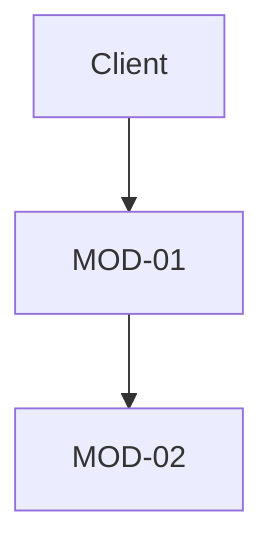
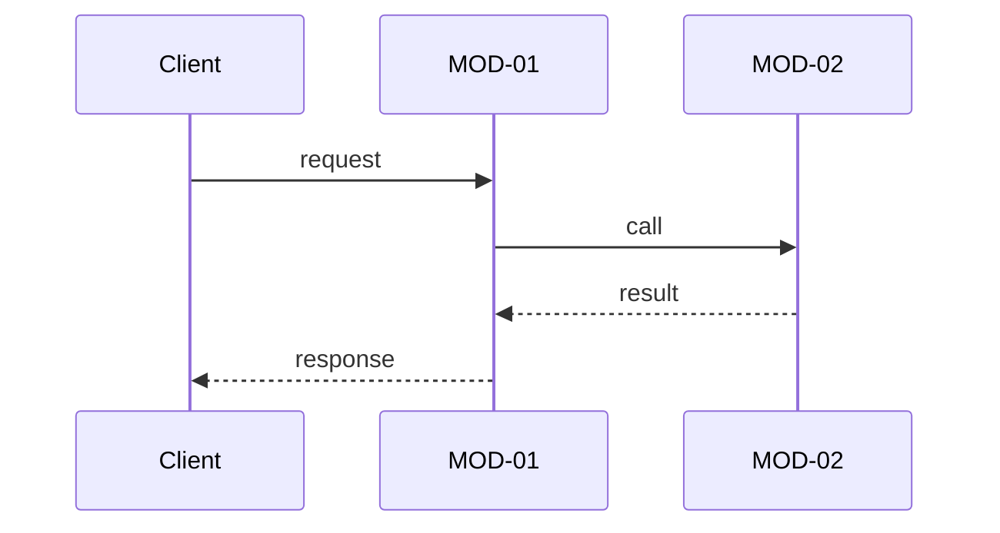

# ARCHITECTURE

> Owned by: **L1 Architect** (`prompts/L1_ARCHITECT.md`).  
> Do not implement code here. Update only via L1 (or human + ADR).

## 1. Architecture Overview

- **Core System Goal:** _[fill]_
- **Non-Goals:** _[fill]_
- **Hardware & Performance Bounds:** _[latency, memory, throughput, platforms]_
- **Target Standards:** _[e.g. C++20 / Rust 2021 / TypeScript 5.x]_

## 2. System Diagrams

### 2.1 Topology

### 2.2 Data & Control Flow

## 3. Cross-Cutting Constraints

- Memory ownership: _[who allocates / frees]_
- Threading / concurrency model: _[single-thread / pool / async]_
- Error model: _[exceptions / Result / error codes — point to contracts]_
- Security / trust boundaries: _[fill]_

## 4. Directives for Level 2 Tech Lead

- High-risk bottlenecks and algorithms:
- Memory ownership, thread-safety, and execution order:
- Modules that must share types via `specs/contracts/`:

## 5. Change Log

| Date | Author | Summary |
|------|--------|---------|
| | L1 | Initial scaffold |
